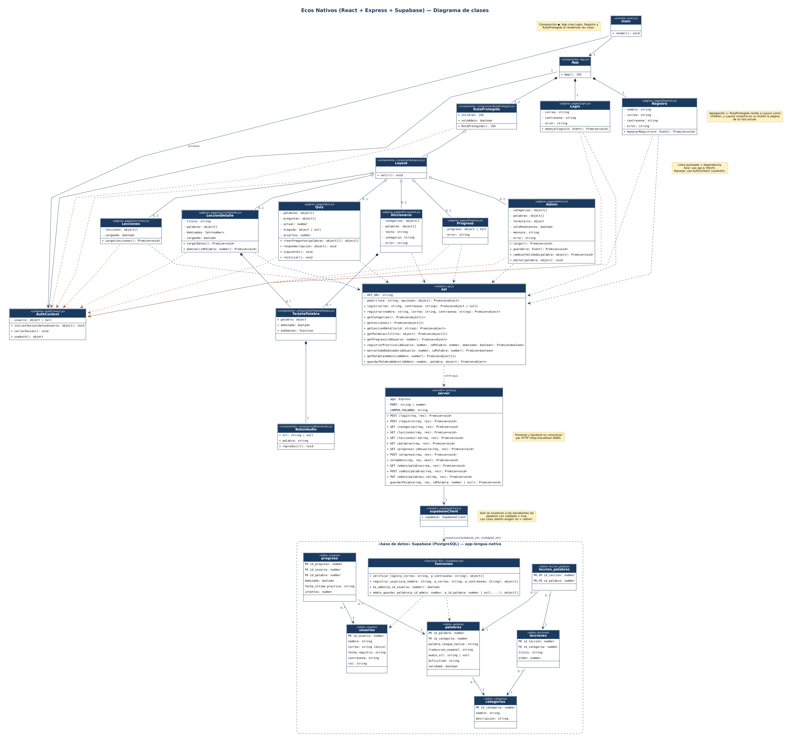

# Ecos Nativos

Aplicación interactiva para aprender la lengua kankuama (kakachukua).
Frontend en React (Vite), backend propio en Node + Express y base de datos en Supabase.

## Qué hace

- **Cuenta e inicio de sesión**: registro, login y sesión que se mantiene al recargar.
- **Lecciones**: 12 lecciones con su vocabulario y botón de audio por palabra.
- **Práctica**: ejercicio de opción múltiple por lección que indica si la respuesta es correcta.
- **Diccionario**: búsqueda por texto y filtro por categoría.
- **Mi progreso**: palabras practicadas y dominadas por usuario.
- **Administración**: el administrador agrega, edita y valida palabras; los estudiantes solo ven las validadas.

## Estructura

```
backend/
  server.js            Rutas de Express
  supabaseClient.js    Conexión con Supabase
frontend/src/
  main.jsx             Entrada: Router + AuthProvider + App
  App.jsx              Rutas de la aplicación
  AuthContext.jsx      Sesión del usuario (contexto)
  api.js               Llamadas al backend
  components/          RutaProtegida, Layout, TarjetaPalabra, BotonAudio
  pages/               Login, Registro, Lecciones, LeccionDetalle, Quiz,
                       Diccionario, Progreso, Admin
```

## Diagrama de clases



## Cómo ejecutarlo

1. Backend
   ```
   cd backend
   npm install
   copy .env.example .env      (y completar SUPABASE_URL y SUPABASE_KEY)
   npm run dev
   ```
2. Frontend (en otra terminal)
   ```
   cd frontend
   npm install
   npm run dev
   ```
3. Abrir http://localhost:5173

## Rutas del backend

| Método | Ruta | Para qué |
|---|---|---|
| POST | /login | Iniciar sesión |
| POST | /registro | Crear cuenta |
| GET | /categorias | Lista de categorías |
| GET | /lecciones | Lista de lecciones |
| GET | /lecciones/:id | Palabras validadas de una lección |
| GET | /palabras?q=&categoria= | Diccionario con búsqueda y filtro |
| GET | /progreso/:idUsuario | Resumen del progreso |
| POST | /progreso | Registrar una práctica |
| GET | /admin/palabras | Todas las palabras (solo administrador) |
| POST | /admin/palabras | Agregar palabra (solo administrador) |
| PUT | /admin/palabras/:id | Editar o validar palabra (solo administrador) |

Fuente del vocabulario: *Anshaye Kakachukua*, Cabildo Indígena del Resguardo Kankuamo.
